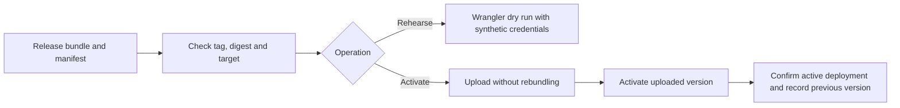

# Worker deploy action

Verify a published Worker module for a selected Cloudflare target. Choose a
synthetic rehearsal or activate the exact release on an existing Worker.

The action checks the target against the release manifest, checked-out
configuration and environment's Worker name. Live activation expects a
provisioned Worker with one version receiving all traffic.

[Configure rehearsal and activation](docs/usage.md) ·
[Release workflow](https://github.com/vhco-pro/worker-release-workflow)
